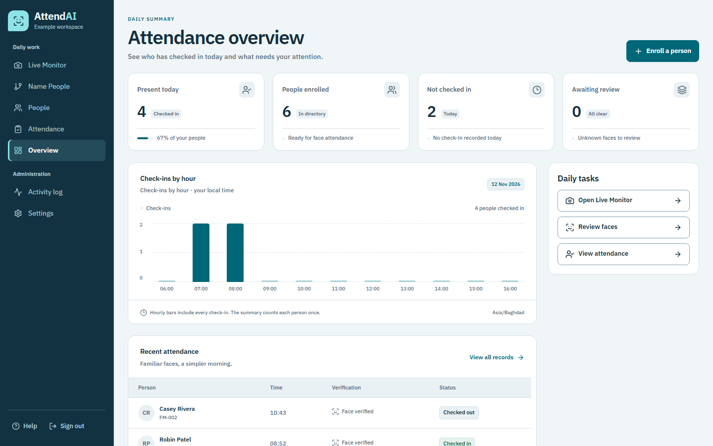
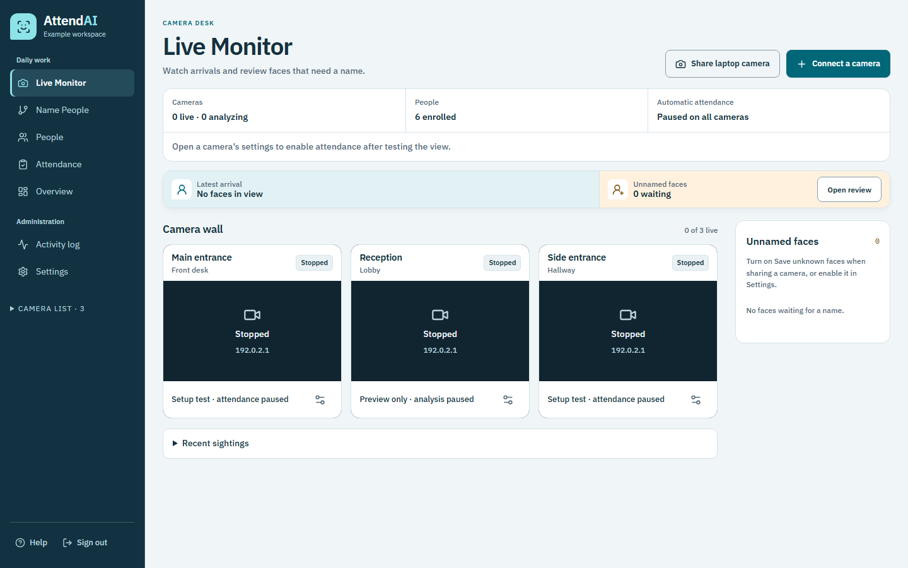
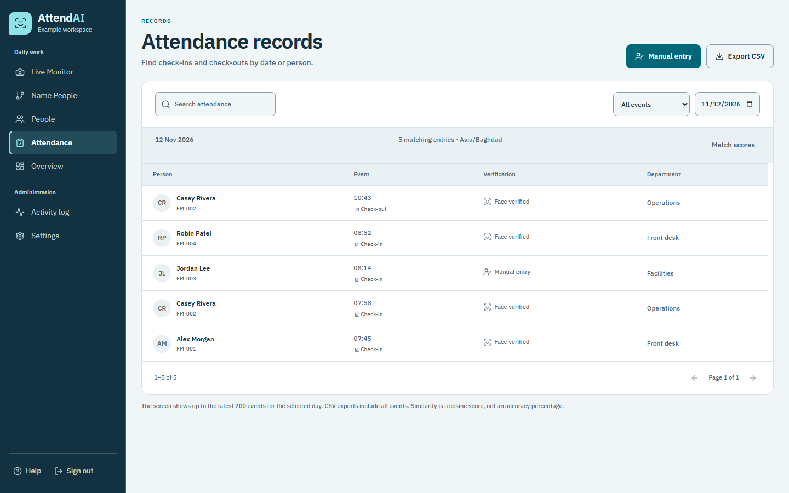

# AttendAI

AttendAI is a Windows application for camera-based attendance. Connect a laptop webcam, USB camera, or network stream to monitor arrivals, review faces, and manage attendance from one workspace. Video analysis runs on the computer hosting the app.



## Screenshots

The example workspace uses fictional people and attendance records.

| Live Monitor | Attendance records |
| --- | --- |
|  |  |

[View the mobile layout](docs/screenshots/mobile.png)

## Install and run

Install **Python 3.12**, **Node.js 22.12 or later**, and Git. Run the following in PowerShell.

```powershell
git clone https://github.com/b1nd03/AttendAI.git
Set-Location AttendAI
powershell -ExecutionPolicy Bypass -File .\setup.ps1
powershell -ExecutionPolicy Bypass -File .\start.ps1
```

Setup installs dependencies, downloads checksum-verified model weights from their upstream sources, and builds the frontend. Open the app and create an administrator password on your first visit. Use a single server process to manage the cameras. [Open AttendAI locally](http://127.0.0.1:8000/)

## Use the workspace

- **Live Monitor** connects webcams and IP cameras. Select **Share laptop camera** or **Connect a camera**. Network cameras accept RTSP, RTSPS, and HTTP/MJPEG stream addresses.
- **Name People** lets an administrator review captured samples, verify identity and consent, and create or update an enrollment. You can also enroll someone from **People**.
- **Attendance** shows check-ins and check-outs, supports manual entries, and exports records as CSV.
- **Settings** controls face review, data retention, and advanced matching. Camera diagnostics show incoming and analyzed frame sizes.

New IP and USB connections start in **Setup test** by default. Use it to check the camera position and face detail before selecting **Live matching**. **Preview only** displays the feed with face analysis paused. A check-in camera can trigger attendance on a verified appearance or a crossing in the configured direction. [Camera setup guide](docs/CAMERA_SETUP.md)

## Data and validation

The app stores workspace records under `data/` by default. Face templates, saved face samples, and camera stream URLs are encrypted with the local key. Protect the database and key together, and stop the server before making a backup. [Architecture and data lifecycle](docs/ARCHITECTURE.md)

Test your camera positions, lighting, and enrolled population before relying on automatic check-ins. The replay tool can evaluate enrolled and unenrolled walks and check printed-photo and screen presentations. [Offline replay guide](docs/FACEMOE_PILOT.md)

## Development

```powershell
.\.venv\Scripts\python.exe tests\make_fixtures.py
.\.venv\Scripts\python.exe -m pytest -q
npx playwright install chromium
npm run test:e2e
npm run format:check
```

The fixture script downloads the upstream detector image used by integration tests. Tests use isolated temporary databases. For frontend development, start the local server with `start.ps1` and run `npm run dev` in a second terminal. [Third-party notices](THIRD_PARTY_NOTICES.md)
